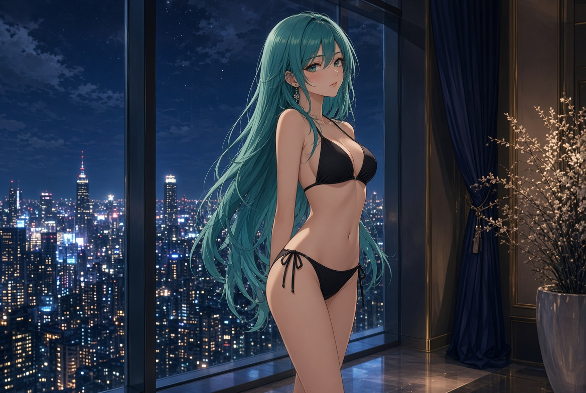
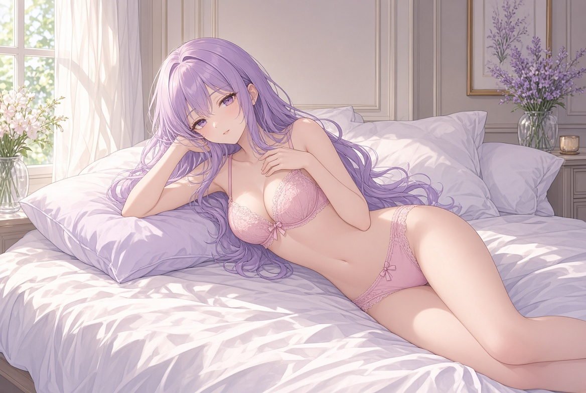
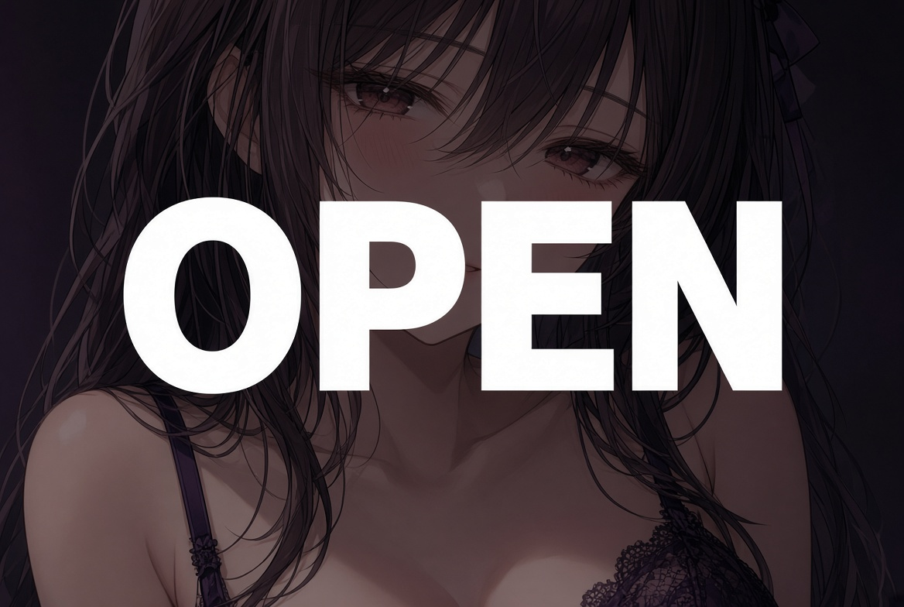

# Create Anime AI Model Without Restrictions and Limits

A short look at browser tools that let you build an anime-style character and talk with fewer limits than the main ChatGPT site. What “no restrictions” usually means in practice, how free tiers work, and what to check before you pay.

[Open options](https://chubby-gf.com/create)

---

## What the phrase usually means

The main ChatGPT site has content limits. Some separate browser tools let you create an anime-style character and continue a conversation with fewer restrictions. You set a name, look and short background. You stay in one thread. Images of the character and voice replies are often on paid plans. The free start is short on most sites.

These are not ChatGPT itself. They are other sites that use similar chat models and add a character builder, image generation and voice. Most ask you to confirm age. “Without restrictions” rarely means unlimited free use. It usually means the character chat itself has fewer content filters. Messages, images and voice still have limits that paid plans raise.

---

## How people usually start

1. Open the site and start the builder or pick a ready anime-style character.  
2. Set a name, look and a short background.  
3. Send a few messages and see if the tone fits.  
4. Stay in that thread if you want earlier details to return.  
5. Upgrade later if you want more messages, pictures or voice.

Memory is better on paid plans. Free tiers forget sooner. Media often uses a meter that runs out. First-month discounts are common. The renewal price is the one that matters.

---

---

## What to check before you pay

| Check | Why it matters |
| --- | --- |
| Free message limit | A handful is not a daily allowance |
| What paid unlocks | More chat, images, voice, or just higher limits |
| Renewal price | First month is often discounted |
| Cancel path | Account page or support ticket |
| Personal data | Do not put real names or numbers in the chat |

A few days of free use is usually enough to see if the character holds the conversation. After that the choice is about media and how long you want to stay in one thread.

---

## Common features

- Anime-style character builder for name, look and background.  
- Ready characters you can open in one click.  
- One thread you can return to.  
- Pictures and voice on higher plans.  
- Browser first. Some have apps.

None of these is a general assistant. The product is built around a character.

---

---

## Notes

- Works in the browser on desktop and phone.  
- Add to home screen if you want an icon.  
- For adults. Confirm age on the site.  
- Prices and limits change. Open the live page before you subscribe.  
- Independent page. Not affiliated with OpenAI or ChatGPT.

---

create anime ai model without restrictions and limits · anime ai chat · ai companion · browser ai chat · custom character · ai chat platforms · virtual companion

  

Independent overview. Prices and features change. Check the live site.
